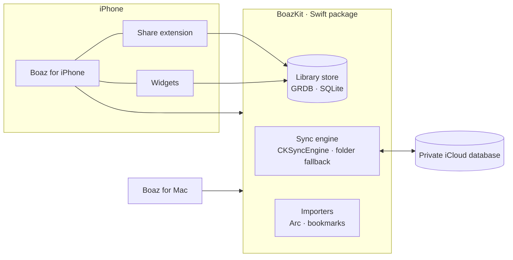

<div align="center">


# Boaz

**A calm web browser for iPhone and Mac.**

On iPhone, the page fills the screen and opens where you left it, with a slim rail for your tabs and a layout
that follows every posture of iPhone Duo. On the Mac, Arc-style spaces. Both stay in step through your private iCloud.

[](https://github.com/chenkahana/Boaz/actions/workflows/ci.yml)


[](LICENSE)

[Features](#features) · [Screenshots](#screenshots) · [Architecture](#architecture) · [Getting started](#getting-started) · [Privacy](#privacy) · [Contributing](#contributing)


</div>

---

## Features

| | |
|---|---|
| **Page first on iPhone** | Boaz opens on the last page you had open. A rail beside the page holds a stack of your previous tabs (most recent on top), **+** for search and **…** for the page menu. Tap the stack for a carousel of your tabs: tap one to open it, swipe one up to archive it. |
| **Spaces on the Mac** | Keep work, home and projects apart. Each space has its own color theme, pinned tabs, folders and favorites. Spaces are a Mac idea; the iPhone shows your tabs without them. |
| **Today and the Archive** | New tabs land in Today. Each device keeps its own Today list, and the iPhone can open the tabs on your Mac. Tabs you haven't opened in a while move to the Archive on their own; pinned tabs stay put. |
| **Search** | Suggestions from your search engine (DuckDuckGo, Google, Bing, Brave, Kagi or Ecosia) mixed with your open tabs, history and address completion. Nothing is sent in Incognito, for addresses, or with suggestions turned off. |
| **Page menu** | Back, Forward, Reload and Share, then Reader, Find on Page, Translate, Listen to Page, text size, desktop or mobile site, and per-site camera, microphone, pop-up and content-blocking settings. |
| **On-device AI** | Summarize Page, Ask This Page and Tidy Tabs, using only Apple's on-device model. Nothing goes to a server. |
| **iCloud sync** | Spaces, pins, folders, favorites and Today sync between iPhone and Mac through your **private** CloudKit database (`CKSyncEngine`). When iCloud is unavailable, a folder you choose works as a fallback. History and Incognito tabs never leave the device. |
| **Built for iPhone Duo** | Folded: the page with the rail beside it, its edges tinted to match the site. Open: a sidebar with search and Today next to the page. Book: sidebar on the left half, page on the right. Laptop: page on top, controls on the lower half. The page is never reloaded as the hinge moves. Standard iPhones get the folded layout. |
| **A full Mac browser** | Arc-style sidebar, command bar (⌘T / ⌘L), split view, rebindable shortcuts, downloads, and a small "Little Boaz" window for links opened from other apps. |
| **Bring Arc with you** | On Mac, import Arc's spaces, pinned folders, favorites, themes, keyboard shortcuts and, if you opt in, cookies as they are. Chrome, Brave, Edge and Safari bookmarks import too. |
| **Private by design** | Built-in ad and tracker blocking (EasyList), cookie-banner declining on iPhone, Incognito tabs and a reader view. No accounts, analytics or third-party SDKs. |
| **System integration** | Share extension ("Add to Boaz"), a search widget, App Shortcuts ("Open in Boaz", "Search in Boaz"), the `boaz://` URL scheme, a default-browser handler on Mac, and alternate app icons. |

## Screenshots

iPhone Duo, folded:

<table>
  <tr>
    <td align="center"><br><sub>The page and the rail</sub></td>
    <td align="center"><br><sub>Your tabs</sub></td>
    <td align="center"><br><sub>Search</sub></td>
    <td align="center"><br><sub>Page menu</sub></td>
  </tr>
</table>

Mac:

<table>
  <tr>
    <td></td>
    <td></td>
  </tr>
</table>

## Architecture

Boaz is two native SwiftUI apps over one shared Swift package. All app targets compile in Swift 6 language mode with
main-actor default isolation; database and sync work runs off the main actor.



| Layer | Path | What it holds |
|---|---|---|
| iPhone app | [`Apps/iOS`](Apps/iOS) | App model, posture-aware shell, tab browser, rail and tab carousel, bottom panels, reader, onboarding, App Intents |
| Mac app | [`Apps/macOS`](Apps/macOS) | Window and sidebar, command bar, key bindings, Arc import UI, onboarding |
| Extensions | [`Apps/Extensions`](Apps/Extensions) | Share extension and WidgetKit widgets |
| Shared UI | [`Apps/Shared`](Apps/Shared) | Theme, assets, onboarding content, privacy manifest |
| Web engine glue | [`Apps/Browser`](Apps/Browser) | WebKit content blocking, downloads, favicons, site colors, search suggestions, on-device AI |
| Core | [`Packages/BoazKit`](Packages/BoazKit) | Records, store and migrations, CloudKit and folder sync, Arc and bookmark importers |

More detail: [docs/architecture.md](docs/architecture.md).

## Getting started

### Requirements

- macOS 26 or later with **Xcode 27.2** (iOS 27.1 SDK)
- [XcodeGen](https://github.com/yonaskolb/XcodeGen) (`brew install xcodegen`)
- An Apple Developer team with the iCloud container `iCloud.com.chenkahana.boaz` and the app group
  `group.com.chenkahana.boaz`, for running on devices and testing sync

### Build and run

```bash
git clone https://github.com/chenkahana/Boaz.git
```

```bash
cd Boaz && make bootstrap
```

```bash
open Boaz.xcodeproj
```

Pick the **Boaz-iOS** scheme with an iPhone Duo simulator, or **Boaz-macOS** for the Mac app. The Xcode project is
generated from [`project.yml`](project.yml) and isn't checked in; run `make project` after changing targets, files
or settings.

### Common tasks

| Command | What it does |
|---|---|
| `make bootstrap` | Checks the toolchain, installs XcodeGen if missing, generates the project |
| `make project` | Regenerates `Boaz.xcodeproj` from `project.yml` |
| `make build` | Builds BoazKit and both apps without code signing (what CI runs) |
| `make archive` | Builds signed Release archives for App Store Connect into `build/archives` |
| `make clean` | Removes build output |

## Repository layout

```
Boaz/
├── Apps/
│   ├── iOS/              iPhone app
│   ├── macOS/            Mac app
│   ├── Extensions/       Share extension, widgets
│   ├── Browser/          WebKit glue shared by both apps
│   └── Shared/           Theme, assets, privacy manifest
├── Packages/BoazKit/    Core library: model, store, sync, importers
├── Tools/                Icon generator
├── docs/                 Architecture, privacy policy, release guide, screenshots
├── .github/              CI, issue and pull-request templates
├── project.yml           XcodeGen project definition
└── Makefile              Developer entry points
```

## Privacy

Boaz collects no data. Your library syncs only through your own private iCloud database, and history stays on the
device. The full policy is in [docs/privacy.md](docs/privacy.md); each app ships a privacy manifest
([`PrivacyInfo.xcprivacy`](Apps/Shared/PrivacyInfo.xcprivacy)).

## Releasing

Versioning, archives, App Store metadata and the review checklist are in [docs/app-store.md](docs/app-store.md).
Changes are recorded in [CHANGELOG.md](CHANGELOG.md).

## Contributing

Bug reports and feature requests are welcome through
[GitHub Issues](https://github.com/chenkahana/Boaz/issues/new/choose). Read [CONTRIBUTING.md](CONTRIBUTING.md) before
opening a pull request, and report security issues as described in [SECURITY.md](SECURITY.md), not in public issues.

## License

Copyright © 2026 Chen Kahana. Boaz is licensed under the [Mozilla Public License 2.0](LICENSE).
Third-party components and their licenses are listed in [THIRD_PARTY_NOTICES.md](THIRD_PARTY_NOTICES.md).
