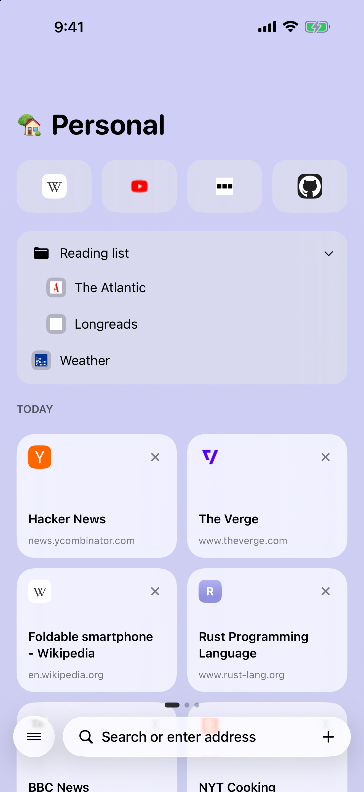
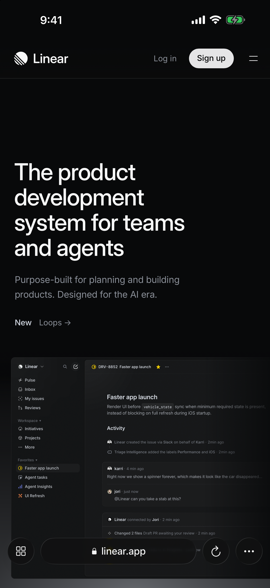
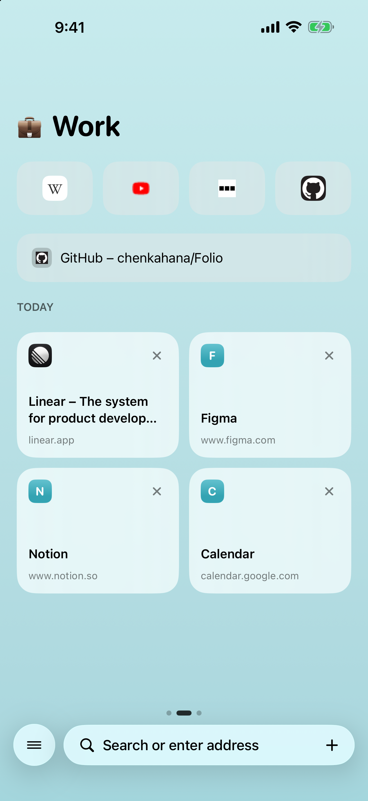
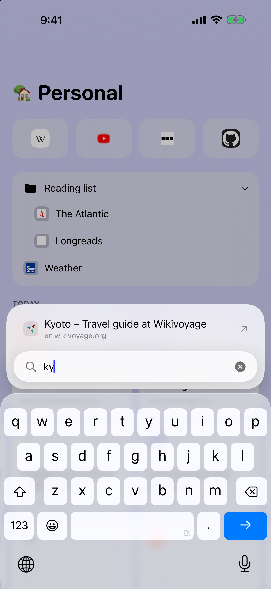
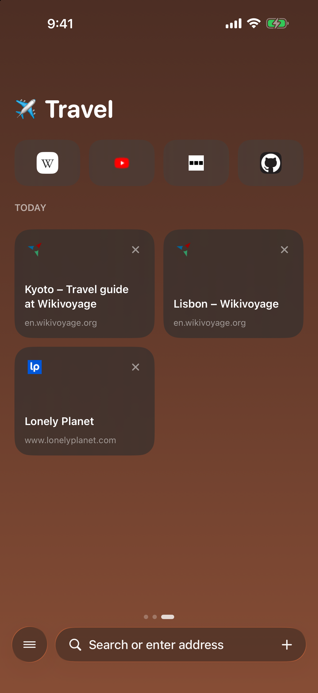
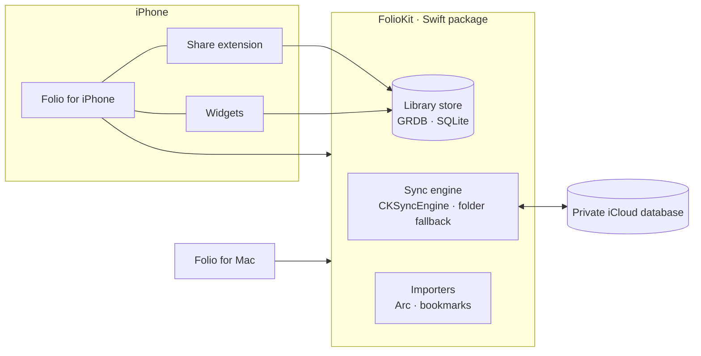

<div align="center">


# Folio

**A calm, spaces-first web browser for iPhone and Mac.**

Spaces, pinned tabs and favorites that stay in step through your private iCloud,
a Today list that tidies itself, and a layout that follows every posture of iPhone Duo.

[](https://github.com/chenkahana/Folio/actions/workflows/ci.yml)


[](LICENSE)

[Features](#features) · [Screenshots](#screenshots) · [Architecture](#architecture) · [Getting started](#getting-started) · [Privacy](#privacy) · [Contributing](#contributing)


</div>

---

## Features

| | |
|---|---|
| **Spaces** | Keep work, home and projects apart. Each space has its own color theme, pinned tabs, folders and favorites; swipe or click to move between them. |
| **Today and the Archive** | New tabs land in Today. Tabs you haven't opened in a while move to the Archive on their own; pinned tabs stay put. |
| **iCloud sync** | Spaces, pins, folders, favorites and Today sync between iPhone and Mac through your **private** CloudKit database (`CKSyncEngine`). When iCloud is unavailable, a folder you choose works as a fallback. History and Incognito tabs never leave the device. |
| **Built for iPhone Duo** | Folded: a single-column home with full-screen tabs. Open: sidebar and page side by side. Book: sidebar on the left half, page on the right. Laptop: page on top, controls on the lower half. The page is never reloaded as the hinge moves. Standard iPhones get the folded layout. |
| **A full Mac browser** | Arc-style sidebar, command bar (⌘T / ⌘L), split view, rebindable shortcuts, downloads, and a small "Little Folio" window for links opened from other apps. |
| **Bring Arc with you** | On Mac, import Arc's spaces, pinned folders, favorites, themes, keyboard shortcuts and, if you opt in, cookies as they are. Chrome, Brave, Edge and Safari bookmarks import too. |
| **Private by design** | Built-in ad and tracker blocking (EasyList), cookie-banner declining on iPhone, Incognito tabs and a reader view. No accounts, analytics or third-party SDKs. |
| **System integration** | Share extension ("Add to Folio"), a search widget, App Shortcuts ("Open in Folio", "Search in Folio"), the `folio://` URL scheme, a default-browser handler on Mac, and alternate app icons. |

## Screenshots

<table>
  <tr>
    <td></td>
    <td></td>
    <td></td>
    <td></td>
    <td></td>
  </tr>
</table>

<table>
  <tr>
    <td></td>
    <td></td>
  </tr>
</table>

## Architecture

Folio is two native SwiftUI apps over one shared Swift package. All app targets compile in Swift 6 language mode with
main-actor default isolation; database and sync work runs off the main actor.



| Layer | Path | What it holds |
|---|---|---|
| iPhone app | [`Apps/iOS`](Apps/iOS) | App model, posture-aware shell, tab browser, reader, onboarding, App Intents |
| Mac app | [`Apps/macOS`](Apps/macOS) | Window and sidebar, command bar, key bindings, Arc import UI, onboarding |
| Extensions | [`Apps/Extensions`](Apps/Extensions) | Share extension and WidgetKit widgets |
| Shared UI | [`Apps/Shared`](Apps/Shared) | Theme, assets, onboarding content, privacy manifest |
| Web engine glue | [`Apps/Browser`](Apps/Browser) | WebKit content blocking, downloads, favicons, site colors |
| Core | [`Packages/FolioKit`](Packages/FolioKit) | Records, store and migrations, CloudKit and folder sync, Arc and bookmark importers |

More detail: [docs/architecture.md](docs/architecture.md).

## Getting started

### Requirements

- macOS 26 or later with **Xcode 27.2** (iOS 27.1 SDK)
- [XcodeGen](https://github.com/yonaskolb/XcodeGen) (`brew install xcodegen`)
- An Apple Developer team with the iCloud container `iCloud.com.chenkahana.folio` and the app group
  `group.com.chenkahana.folio`, for running on devices and testing sync

### Build and run

```bash
git clone https://github.com/chenkahana/Folio.git
```

```bash
cd Folio && make bootstrap
```

```bash
open Folio.xcodeproj
```

Pick the **Folio-iOS** scheme with an iPhone Duo simulator, or **Folio-macOS** for the Mac app. The Xcode project is
generated from [`project.yml`](project.yml) and isn't checked in; run `make project` after changing targets, files
or settings.

### Common tasks

| Command | What it does |
|---|---|
| `make bootstrap` | Checks the toolchain, installs XcodeGen if missing, generates the project |
| `make project` | Regenerates `Folio.xcodeproj` from `project.yml` |
| `make build` | Builds FolioKit and both apps without code signing (what CI runs) |
| `make archive` | Builds signed Release archives for App Store Connect into `build/archives` |
| `make clean` | Removes build output |

## Repository layout

```
Folio/
├── Apps/
│   ├── iOS/              iPhone app
│   ├── macOS/            Mac app
│   ├── Extensions/       Share extension, widgets
│   ├── Browser/          WebKit glue shared by both apps
│   └── Shared/           Theme, assets, privacy manifest
├── Packages/FolioKit/    Core library: model, store, sync, importers
├── Tools/                Asset generators
├── docs/                 Architecture, privacy policy, release guide, screenshots
├── .github/              CI, issue and pull-request templates
├── project.yml           XcodeGen project definition
└── Makefile              Developer entry points
```

## Privacy

Folio collects no data. Your library syncs only through your own private iCloud database, and history stays on the
device. The full policy is in [docs/privacy.md](docs/privacy.md); each app ships a privacy manifest
([`PrivacyInfo.xcprivacy`](Apps/Shared/PrivacyInfo.xcprivacy)).

## Releasing

Versioning, archives, App Store metadata and the review checklist are in [docs/app-store.md](docs/app-store.md).
Changes are recorded in [CHANGELOG.md](CHANGELOG.md).

## Contributing

Bug reports and feature requests are welcome through
[GitHub Issues](https://github.com/chenkahana/Folio/issues/new/choose). Read [CONTRIBUTING.md](CONTRIBUTING.md) before
opening a pull request, and report security issues as described in [SECURITY.md](SECURITY.md), not in public issues.

## License

Copyright © 2026 Chen Kahana. All rights reserved. The source is published for reference; see [LICENSE](LICENSE).
Third-party components and their licenses are listed in [THIRD_PARTY_NOTICES.md](THIRD_PARTY_NOTICES.md).
