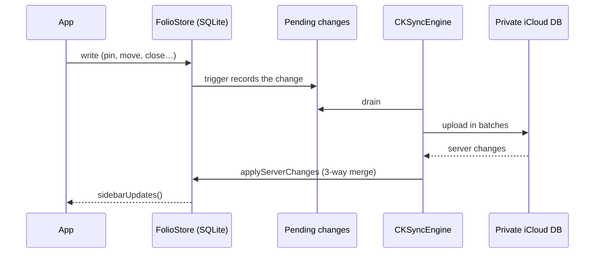

# Architecture

Folio is two native SwiftUI apps (iPhone and Mac) and two iOS extensions over one Swift package, **FolioKit**. This
document explains how the pieces fit together and the rules each layer follows.

## Targets

| Target | Platform | Sources | Bundle ID |
|---|---|---|---|
| Folio-iOS | iOS 27.1+ (iPhone; iPad in compatibility mode) | `Apps/iOS`, `Apps/Shared`, `Apps/Browser` | `com.chenkahana.folio` |
| Folio-macOS | macOS 26+ | `Apps/macOS`, `Apps/Shared`, `Apps/Browser` | `com.chenkahana.folio` |
| ShareExtension | iOS | `Apps/Extensions/ShareExtension`, `Apps/Shared` | `com.chenkahana.folio.share` |
| Widgets | iOS | `Apps/Extensions/Widgets`, `Apps/Shared` | `com.chenkahana.folio.widgets` |
| FolioKit | iOS 17+, macOS 14+ (Swift package) | `Packages/FolioKit` | — |

The iPhone and Mac apps share one bundle ID, so they are one App Store record (universal purchase) and one iCloud
App ID. The iOS app and its extensions share the app group `group.com.chenkahana.folio`, where the library database
lives. Targets, entitlements and Info.plist keys are defined in [`project.yml`](../project.yml); the Xcode project is
generated from it.

## Concurrency

App targets use Swift 6 with `SWIFT_DEFAULT_ACTOR_ISOLATION = MainActor`: views and models are main-actor by default.
FolioKit has no default isolation. Everything that touches SQLite, CloudKit or the file system runs off the main
actor through FolioKit's `async` API, so the UI never blocks on I/O. When several reloads race, a generation counter
makes sure only the newest result is applied.

## Data model

All records are GRDB value types in `Model/Records.swift`:

- **Profile**: a browsing profile, with its own `WKWebsiteDataStore` (cookies and site data).
- **Space**: belongs to a profile; has a name, icon, color theme (`WindowTheme`) and order.
- **SidebarItem**: a tree per space. Containers (`pinned`, `unpinned` = Today, `favorites`) hold folders and tabs.
  Order is explicit, so every device shows the same sequence.
- **ArchiveItem**: a closed or auto-archived tab.
- **HistoryVisit**: local only. History is never synced.

`FolioStore` is the single source of truth on each device. It opens a `DatabasePool` (WAL mode) in the app group,
runs versioned migrations (`v1`, `v2-history`, `v3-sync`, …) and exposes reads such as `loadSidebar()` and writes
such as `archiveStaleTabs()`. A shipped migration is never edited; schema changes add a new one.

`StarterLibrary` seeds a new library with fixed IDs, so two devices that start fresh merge into one library instead
of duplicating it.

## Sync

- **Transport.** `LibrarySync` is the only sync object the apps use. When the build has the iCloud entitlement and
  an account is signed in, `CloudKitSync` mirrors the store to the private database (zone `Folio`) with
  `CKSyncEngine`. Otherwise a folder the user picks (`FolderSync`) is the fallback. Only one transport runs at a time;
  both drain the same queue.
- **Change capture.** Database triggers write every local change to `SyncPendingChange`, so no write path can forget
  to sync.
- **Conflicts.** `SyncMerge` does a per-field three-way merge against the last server copy (`SyncRecordMeta`). A field
  changed on one side keeps that change; a field changed on both sides goes to the newer edit. The folder transport
  uses per-field timestamps (`RecordState`) so devices converge without a server.
- **Deletes** are kept as tombstones for 30 days so slower devices learn about them, then purged; the purge is
  queued like any change, so the CloudKit record goes too. Arc-imported rows keep their tombstones, so re-importing
  from Arc doesn't bring back what was removed in Folio.
- **What syncs:** profiles, spaces, sidebar items and the archive (`SyncRecordType`). History, Incognito tabs, page
  snapshots and cookies never leave the device.

## Browsing

Both apps render pages with WebKit. Shared glue in `Apps/Browser` handles:

- **Content blocking:** EasyList compiled into `WKContentRuleList`s, on by default for every page.
- **Downloads**, **favicons** (fetched from each site directly) and **site colors** for tab tinting.

Platform specifics live in each app: on iPhone, cookie-banner declining, the reader view, pull to refresh and the
navigation policy; on Mac, the sidebar window, split view, command bar and rebindable shortcuts.

## iPhone Duo postures

`RootView` picks a layout from the size class and the hinge **state**; the raw hinge angle only drives effects such
as the fold glow.

| Posture | Layout |
|---|---|
| Folded (cover screen) | `CompactShell`: space home, with the active tab zooming out of its card |
| Open, wide | Sidebar beside the page; the sidebar can be hidden |
| Open, narrow | Page full width; the sidebar floats over it as a card |
| Book (fold vertical) | Sidebar fills the left half up to the fold, page on the right |
| Laptop (fold horizontal) | Page on the upper half, Today tabs and the address bar on the lower half |

Every open posture uses the same view tree (`UnfoldedShell`), so the web view is never rebuilt as the device folds.
The fold position comes from the system's reserved regions rather than from hard-coded sizes. Standard iPhones use
the folded layout.

## Importers (Mac)

- **Arc sidebar:** reads `StorableSidebar.json` and recreates profiles, spaces, pinned folders, favorites and themes
  in the same order.
- **Arc shortcuts:** maps `StorableKeyBindings.json` overrides onto Folio's commands.
- **Arc cookies (opt-in):** decrypts Arc's cookie database with the "Arc Safe Storage" Keychain key (macOS asks the
  user first) and writes the cookies only into the matching profile's local `WKWebsiteDataStore`. They are never
  stored in the Folio database or synced.
- **Bookmarks:** Chrome, Brave, Edge and Safari bookmark files become pinned tabs and folders.

Folio does not import saved passwords. `ArcPasswordImporter.swift` is excluded from the package build.

## Privacy and security

- Folio uses no analytics, crash reporting or third-party SDKs that collect data. `PrivacyInfo.xcprivacy` declares no
  tracking and no collected data, plus the required-reason APIs used.
- The Mac app is sandboxed. It reads other browsers' data only from folders the user selects, through
  security-scoped bookmarks.
- See [privacy.md](privacy.md) for the user-facing policy and [SECURITY.md](../SECURITY.md) for vulnerability
  reporting.
